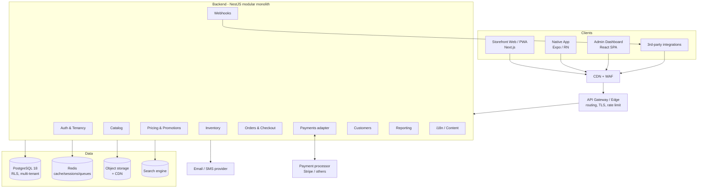

# Architecture & Technical Design — Mercato

**Version:** 1.0 (draft) · **Date:** 2026-06-19 · Companion to `01-PRD.md`

---

## 1. Architecture principles

1. **API-first / headless.** The backend exposes one well-documented API. Every client — web storefront, PWA, native app, integrations — is just a consumer. No business logic lives in clients.
2. **Database-enforced isolation.** Tenant isolation is enforced by PostgreSQL Row-Level Security, not only by application `WHERE` clauses. A bug in app code must not be able to leak another tenant's data.
3. **Modular monolith first, extractable later.** Start as one deployable backend organized into strict modules with clean interfaces. Extract a module into its own service only when scale or team boundaries demand it. This avoids premature distributed-systems complexity.
4. **Everything is localizable.** No user-facing string, price, or date is hard-coded or locale-assumed.
5. **Stateless services, shared nothing in process.** All state lives in Postgres, Redis, or object storage so the API scales horizontally.
6. **Events for side effects.** State changes emit domain events (via a transactional outbox) so reporting, search indexing, emails, and webhooks react asynchronously without coupling.

---

## 2. Recommended stack

The requested stack (Node/TypeScript, React, Postgres) is the right choice and is kept. Specific framework picks below, with versions current as of June 2026 and rationale. Treat versions as "current stable — confirm at setup."

| Layer | Recommendation | Version (Jun 2026) | Why / alternatives |
|-------|----------------|--------------------|--------------------|
| **Language** | TypeScript (strict) | 5.x | End-to-end type safety, shared types between client and server. |
| **Backend framework** | **NestJS** | 11.1 | Opinionated modular structure with DI — ideal for a modular monolith that may later split into services. *Alt:* Fastify + tRPC (lighter, less structure). |
| **ORM / DB toolkit** | **Drizzle ORM** | latest | SQL-first, lightweight, **first-class Postgres RLS support** and easy `SET LOCAL` for tenant context. *Alt:* Prisma (great DX, RLS support maturing). |
| **Database** | **PostgreSQL** | 18.4 | RLS, JSONB, full-text search, partitioning, mature replication. |
| **Cache / sessions / queues** | **Redis** | 7.x | Cart/session store, rate limiting, cache, and BullMQ job queue. |
| **Background jobs** | **BullMQ** | latest | Redis-backed jobs for emails, indexing, exports, webhooks. |
| **Search** | Postgres FTS (MVP) → **Meilisearch** or OpenSearch (P2) | — | Start cheap in-DB; move to a dedicated engine for typo-tolerance/facets at scale. |
| **Object storage** | S3-compatible (AWS S3 / Cloudflare R2) + CDN | — | Product media, exports. CDN (Cloudflare/CloudFront) in front. |
| **Storefront + PWA** | **Next.js** (App Router) | 16.2 LTS | SSR/ISR for SEO + speed, built-in PWA, React 19. *Alt:* Remix/React Router. |
| **Admin dashboard** | **React + Vite** SPA | React 19 | App-like, no SEO need; fast SPA. *Alt:* Next.js if you prefer one framework. |
| **Native mobile** | **Expo (React Native)** | SDK 56 (RN 0.85) | One codebase for iOS/Android against the same API; shares TS types & i18n catalogs. |
| **i18n** | **i18next** / react-i18next + ICU MessageFormat; `Intl` for formatting | latest | Pluralization, interpolation, RTL; runtime + SSR support. |
| **Auth** | JWT access + refresh tokens; OIDC/SSO later | — | Stateless, tenant-aware tokens. *Alt:* Auth.js / managed (Clerk, WorkOS) for speed. |
| **API contract** | OpenAPI 3.1 (generated from Nest) | — | Generates typed clients for web/mobile, plus docs. |
| **Infra** | Docker + managed containers (ECS/Fargate, Fly, or K8s); Terraform IaC | — | Stateless API scales horizontally; managed Postgres + Redis. |
| **CI/CD** | GitHub Actions; trunk-based; preview envs | — | Lint, test, isolation tests, migration checks, deploy. |

---

## 3. System context



---

## 4. Multi-tenancy design (the core decision)

**Model chosen: shared database, shared schema, `store_id` discriminator, enforced by PostgreSQL Row-Level Security (RLS).** This is the most cost-effective model and scales to thousands of stores per database node, with a clean upgrade path to per-tenant databases for enterprise customers in Phase 3.

### 4.1 Tenancy hierarchy

- `organization_id` — the merchant account (billing, plan, staff membership).
- `store_id` — **the isolation boundary.** Every business-data table carries `store_id`.
- A store belongs to exactly one organization; an organization owns one or many stores.
- Cross-store reporting for an org is allowed *because the org owns those stores* — authorized at the app layer over the set of `store_id`s the user may access.

### 4.2 How isolation is enforced

Two layers, defense in depth:

1. **Application layer** — every request carries a resolved `store_id` (see 4.3). The data-access layer always scopes queries to it.
2. **Database layer (authoritative)** — RLS policies on every tenant table reject rows whose `store_id` ≠ the current session's store. Even a missing `WHERE` clause or an injection cannot cross tenants. Policies are **default-deny**.

Per request, the API opens a transaction and sets a session variable, then runs queries on that connection:

```sql
-- set once per request/transaction, from the authenticated context
SET LOCAL app.current_store_id = '<uuid>';

-- example policy (see 03-data-model.md for the full set)
CREATE POLICY tenant_isolation ON products
  USING (store_id = current_setting('app.current_store_id')::uuid)
  WITH CHECK (store_id = current_setting('app.current_store_id')::uuid);
```

Key rules:
- The app connects as a role **without** `BYPASSRLS`. Migrations/admin jobs use a separate privileged role.
- `SET LOCAL` is transaction-scoped, so it cannot leak across pooled connections. Use transaction-mode pooling (PgBouncer) compatible with this.
- Org-level cross-store queries set the context per store, or use a dedicated reporting path with an explicit, authorized list of `store_id`s.

### 4.3 Tenant resolution flow

The active store is resolved early in the request pipeline, in priority order:

1. **Custom domain / subdomain** — `acme.com` or `acme.platform.com` → `store_id` (storefront traffic).
2. **JWT claim** — staff and API tokens embed the `store_id`(s) they're scoped to (admin/API traffic).
3. **Explicit header** — `X-Store-Id` for tools/integrations, validated against the caller's permissions.

A `TenantMiddleware` resolves and validates the store, loads its settings (locales, currency, theme), and injects `store_id` into the request context and the DB session. Requests with no resolvable, authorized store are rejected.

### 4.4 Scaling and escape hatches

- **Noisy-neighbor control:** per-store rate limits, connection-pool fairness, read replicas for heavy reads (reporting/search).
- **Hot tenants:** a large store can be moved to a dedicated DB/cluster; because all access goes through the same data layer keyed by `store_id`, this is a routing change, not a rewrite.
- **Enterprise isolation (P3):** optional database-per-tenant. A tenant→connection registry maps `store_id` to a datasource; the rest of the code is unchanged.
- **Data residency:** stores can be pinned to a region's cluster via the same routing layer.

---

## 5. Backend module decomposition

A NestJS modular monolith. Each module owns its tables, services, and API surface, and communicates with others through typed service interfaces and domain events — never by reaching into another module's tables.

| Module | Responsibility |
|--------|----------------|
| **Platform/Tenancy** | Organizations, stores, provisioning, store settings, plan/limits. |
| **Identity & Access** | Staff users, customers, authentication, sessions, RBAC, API keys, audit log. |
| **Catalog** | Products, variants, attributes, categories, collections, media, translations. |
| **Pricing & Promotions** | Price lists per currency, customer-group pricing, discount codes, automatic promotions, stacking rules. |
| **Inventory** | Stock per SKU/location, reservations, adjustments, low-stock alerts. |
| **Cart & Checkout** | Cart lifecycle, pricing calculation, tax/shipping quote, checkout orchestration. |
| **Orders & Fulfillment** | Orders, payments capture/refund, fulfillment, returns/RMA. |
| **Payments** | Provider-agnostic adapter (Stripe first), tokenization, webhooks from processor. |
| **Reporting** | Read-optimized sales/inventory analytics, cross-store roll-ups, exports. |
| **i18n/Content** | Locale config, translation storage and resolution, content fallback. |
| **Notifications** | Transactional email/SMS templates (localized), delivery. |
| **Webhooks/Integrations** | Outbound webhooks, API for third parties. |

**Boundaries:** modules expose interfaces; cross-module reads go through those interfaces or a reporting read-model. This is what makes later extraction into services cheap.

---

## 6. Eventing, jobs, and consistency

- **Transactional outbox:** domain events are written in the same DB transaction as the state change, then published asynchronously by a relay. Guarantees no lost or phantom events.
- **Consumers:** search indexing, report aggregation, low-stock alerts, email/SMS, outbound webhooks.
- **Jobs (BullMQ on Redis):** CSV import/export, bulk price updates, report generation, webhook delivery with retries/backoff, scheduled price activation.
- **Idempotency:** checkout and payment endpoints require idempotency keys; webhook handlers are idempotent.
- Start as in-process event bus + outbox; swap the transport for Kafka/NATS in P3 if a module is extracted.

---

## 7. API layer

- **Style:** REST with OpenAPI 3.1, generated from NestJS decorators. Typed SDKs generated for web, admin, and mobile. A GraphQL BFF can be added later for the storefront if query flexibility is needed.
- **Two surfaces:**
  - **Storefront API** — public, read-heavy (catalog, search, cart, checkout), cached at the edge, scoped to a store by domain.
  - **Admin API** — authenticated, write-heavy, scoped by JWT store claims and RBAC.
- **Auth:** short-lived JWT access tokens + rotating refresh tokens. Web uses httpOnly secure cookies; mobile uses secure storage. Tokens embed `organization_id`, accessible `store_id`(s), and role.
- **Versioning:** URI version (`/v1`) plus additive-change discipline; deprecations announced via headers.
- **Rate limiting & quotas:** per IP, per API key, and per store. Returns standard `429` with retry headers.
- **Idempotency & pagination:** idempotency keys on mutations; cursor pagination on list endpoints.

See `04-api-spec.md` for the resource map.

---

## 8. Clients

### 8.1 Storefront (Next.js, web + PWA)
- App Router with SSR/ISR for SEO and fast first paint; product and listing pages cached/ISR, cart/checkout dynamic.
- **PWA:** service worker for offline browsing of cached catalog, "add to home screen", push notifications (P2). Installable on mobile/desktop.
- Theme/branding driven by store settings; reference theme is the starting point.
- Locale + currency from URL (`/{locale}/...`) and store config; RTL-aware.

### 8.2 Native mobile (Expo / React Native, Phase 2)
- Same API and generated TS client; shares i18n catalogs and types with web via the monorepo.
- Over-the-air updates via Expo; push notifications for order status.

### 8.3 Admin dashboard (React + Vite SPA)
- **Store switcher** in the top bar: operate a single store or switch/aggregate across an org's stores.
- Role-aware UI (hide what the user can't do); all actions audited server-side.
- Localized for staff languages too.

---

## 9. Internationalization architecture

- **UI strings:** i18next catalogs per locale, lazy-loaded; ICU MessageFormat for plurals/gender/interpolation. Shared catalog package consumed by storefront, admin, and mobile.
- **Content translations:** product/category/CMS fields stored as translatable values keyed by locale (see data model §translations). Resolution order: requested locale → store default locale → base. Missing translations fall back gracefully.
- **Formatting:** `Intl` APIs for dates, numbers, and currency, driven by the active locale; never hand-rolled.
- **Currency:** prices stored per currency in price lists (not naive FX conversion). Display and checkout currency chosen from the store's enabled currencies; minor-unit-safe integer money handling.
- **RTL:** logical CSS properties, `dir="rtl"` switching, mirrored components; Arabic/Hebrew tested in the reference theme.
- **SEO (P2):** localized URLs, `hreflang`, per-locale metadata and sitemaps.

---

## 10. Search

- **MVP:** PostgreSQL full-text search (`tsvector`, GIN indexes) per store — good enough for typical catalogs, no extra infra, RLS-safe.
- **P2:** Meilisearch (typo tolerance, instant search, facets) or OpenSearch at larger scale. Indexed per store via the event pipeline; queries filtered by `store_id`. Postgres remains source of truth.

---

## 11. Caching

- **Edge/CDN:** cache storefront catalog responses and assets; purge on catalog events.
- **Redis:** hot data (store settings, sessions, cart), computed price/promo results, rate-limit counters.
- **Cache keys are namespaced by `store_id`** to prevent cross-tenant cache poisoning.
- **ISR** in Next.js for product/listing pages with on-demand revalidation triggered by catalog events.

---

## 12. Payments and integrations

- **Provider-agnostic adapter.** A `PaymentProvider` interface (authorize, capture, refund, vault, webhook-verify) with Stripe as the first implementation; Adyen/PayPal/regional gateways added without touching order logic.
- **PCI posture:** card data is collected by the processor's hosted fields/SDK and never touches our servers (SAQ-A). We store only processor tokens.
- **Processor webhooks** verified by signature and processed idempotently (payment succeeded/failed, dispute, refund).
- **Other integrations (later):** tax services (Avalara/TaxJar), carrier rates (Shippo/EasyPost), ESP/marketing, analytics — all behind adapters.

---

## 13. Security

- DB-level RLS (the centerpiece) + app-level scoping; app role lacks `BYPASSRLS`.
- JWT with short TTL + refresh rotation; secure, httpOnly cookies on web; secrets in a managed secret store.
- RBAC with store-scoped roles; principle of least privilege; every admin mutation written to an immutable audit log with `actor`, `store_id`, `before/after`.
- OWASP Top 10 controls: input validation (zod/DTO), parameterized queries (ORM), output encoding, CSRF protection on cookie auth, CORS allow-list per store domain, security headers/CSP, WAF at the edge.
- Encryption in transit (TLS everywhere) and at rest (DB, backups, object storage).
- Per-tenant data export and hard-delete to satisfy GDPR/CCPA erasure.
- Secrets/keys rotation; dependency and container scanning in CI.

---

## 14. Observability & ops

- **Structured logging** with `request_id`, `organization_id`, `store_id`, `actor` on every line.
- **Tracing** (OpenTelemetry) across API → DB → jobs; **metrics** (RED/USE) per endpoint and per tenant; dashboards + alerting (error budget, checkout success rate, queue depth, DB connections).
- **Health/readiness** probes; graceful shutdown drains in-flight requests and jobs.
- **Migrations** versioned and run in CI with a forward-only policy; tenant-isolation tests run on every PR (a test that asserts store A cannot read store B's rows).
- **Backups:** automated PITR for Postgres; object-storage versioning; restore drills.

---

## 15. Infrastructure & deployment

```
Internet
  │
  ▼
CDN + WAF (Cloudflare/CloudFront)
  │            └── static assets, cached storefront, product media
  ▼
API edge / load balancer  ── TLS termination, routing, global rate limit
  │
  ▼
Stateless API (NestJS) ── auto-scaled containers (ECS/Fargate, Fly, or K8s)
  │           │            │
  ▼           ▼            ▼
Postgres 18   Redis 7      Object storage (S3/R2)
(+ read       (cache,      (+ CDN)
 replicas,    queues,
 PITR)        sessions)
  │
  ▼
Search engine (P2)        Workers (BullMQ) ── jobs, outbox relay, webhooks
```

- **Environments:** dev → staging → production, with ephemeral preview environments per PR.
- **IaC:** Terraform for all cloud resources; everything reproducible.
- **CI/CD:** GitHub Actions — lint, typecheck, unit/integration tests, RLS isolation tests, migration dry-run, build, deploy with health-gated rollout and easy rollback.
- **Scaling:** API and workers scale horizontally and independently; Postgres scales via vertical sizing + read replicas, then per-tenant DBs for the largest customers (P3).

---

## 16. Monorepo layout

A single repo (pnpm workspaces + Turborepo) so types, i18n catalogs, and the API client are shared.

```
mercato/
├─ apps/
│  ├─ api/              # NestJS backend (modular monolith)
│  ├─ storefront/       # Next.js web + PWA
│  ├─ admin/            # React + Vite admin SPA
│  └─ mobile/           # Expo / React Native (Phase 2)
├─ packages/
│  ├─ db/               # Drizzle schema, migrations, RLS policies
│  ├─ api-client/       # generated typed SDK from OpenAPI
│  ├─ i18n/             # shared locale catalogs + helpers
│  ├─ ui/               # shared React components / design tokens
│  ├─ config/           # eslint, tsconfig, tailwind presets
│  └─ core/             # shared domain types, money utils, validation
├─ infra/               # Terraform, Docker, CI workflows
└─ docs/                # this spec set
```

---

## 17. Key architectural decisions (ADR summary)

| # | Decision | Rationale | Revisit when |
|---|----------|-----------|--------------|
| ADR-1 | Shared schema + `store_id` + RLS | Lowest cost, scales to many tenants, DB-enforced isolation | Enterprise needs full DB isolation → add DB-per-tenant routing (P3) |
| ADR-2 | Modular monolith (NestJS) over microservices | Avoid premature distribution; fast to build; clean module seams | A module's scale/team forces extraction |
| ADR-3 | Drizzle ORM | SQL-first, strong RLS/`SET LOCAL` ergonomics | If team prefers Prisma DX and RLS support suffices |
| ADR-4 | REST + OpenAPI primary | Typed clients + docs for free; simplest for many consumers | Storefront needs flexible querying → add GraphQL BFF |
| ADR-5 | Prices stored per currency (price lists) | Correct international pricing; avoids FX drift | — |
| ADR-6 | Postgres FTS at MVP, dedicated search later | Defer infra cost until catalogs/scale need it | Search quality/scale degrades → Meilisearch/OpenSearch |
| ADR-7 | Stripe-first behind a payment adapter | Ship fast without lock-in | New market needs another gateway → add adapter |
