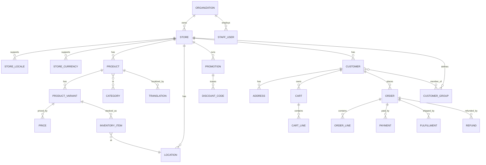

# Data Model & Tenant Isolation (RLS) — Mercato

**Version:** 1.0 (draft) · **Date:** 2026-06-19 · Companion to `02-architecture.md`

This document defines the core relational model and the PostgreSQL Row-Level Security (RLS) policies that enforce tenant isolation. It is the contract the `packages/db` schema implements.

---

## 1. Conventions

- **Primary keys:** UUID v7 (time-ordered) for index locality.
- **Tenant key:** every business table carries `store_id uuid NOT NULL` (the isolation boundary). Account-level tables carry `organization_id`.
- **Timestamps:** `created_at`, `updated_at` (UTC, `timestamptz`); `deleted_at` for soft delete where needed.
- **Money:** stored as **integer minor units** (e.g., cents) plus a `currency` (ISO 4217) — never floats. A `money` composite is represented as `(amount_minor bigint, currency char(3))`.
- **Translatable text:** stored via a translations pattern (see §4), not duplicated columns per language.
- **Enums:** Postgres enums or check-constrained text for statuses.
- **Audit:** sensitive tables get rows in an `audit_log` via triggers/app layer.
- **No `BYPASSRLS`** on the application role.

---

## 2. Entity-relationship overview



---

## 3. Core tables (key columns)

Only the defining columns are shown; standard timestamps/soft-delete omitted for brevity.

### Platform & access
```
organization(id, name, plan, billing_status, owner_user_id, created_at)
store(id, organization_id, slug, primary_domain, name,
      default_locale, default_currency, timezone, theme_id, status)
store_locale(id, store_id, locale, is_default, enabled)
store_currency(id, store_id, currency, is_default, enabled, rounding_rule)
staff_user(id, organization_id, email, password_hash, name, status)
role(id, organization_id, name, permissions jsonb)            -- e.g. catalog:write
staff_membership(id, staff_user_id, store_id NULLABLE, role_id) -- store_id NULL = org-wide
api_key(id, store_id, name, hashed_key, scopes, last_used_at)
audit_log(id, store_id, actor_user_id, action, entity, entity_id,
          before jsonb, after jsonb, created_at)
```
> `staff_membership.store_id = NULL` grants the role across all stores in the org (e.g., Org Owner). A specific `store_id` scopes the role to one store.

### Catalog
```
product(id, store_id, slug, status, type, primary_image_id, ...)
product_option(id, store_id, product_id, name, position)        -- e.g. Size
product_option_value(id, store_id, option_id, value)            -- e.g. M, L
product_variant(id, store_id, product_id, sku, barcode,
                option_values jsonb, weight, position, status)
category(id, store_id, parent_id, slug, position)
product_category(store_id, product_id, category_id)             -- M:N
collection(id, store_id, slug, type, rules jsonb)               -- manual or smart
media_asset(id, store_id, url, alt, type, position, owner_type, owner_id)
attribute(id, store_id, code, type)                             -- custom attributes
attribute_value(id, store_id, attribute_id, owner_id, value jsonb)
```

### Pricing & promotions
```
price_list(id, store_id, name, currency, customer_group_id NULLABLE)
price(id, store_id, price_list_id, variant_id, amount_minor,
      starts_at, ends_at, min_quantity)                          -- scheduled/sale/tiered
promotion(id, store_id, name, type, rules jsonb, actions jsonb,
          priority, stackable, starts_at, ends_at, status)       -- automatic promos
discount_code(id, store_id, promotion_id, code, usage_limit,
              per_customer_limit, used_count, status)
```

### Inventory
```
location(id, store_id, name, address jsonb, is_default)
inventory_item(id, store_id, variant_id, location_id,
               on_hand, reserved, reorder_point, backorder_policy)
inventory_movement(id, store_id, inventory_item_id, delta, reason,
                   reference_type, reference_id, created_at)     -- audit of stock changes
```

### Customers
```
customer(id, store_id, email, password_hash NULLABLE, name,
         locale, accepts_marketing, status)                     -- unique (store_id, email)
address(id, store_id, customer_id, name, line1, line2, city,
        region, postal_code, country, phone, is_default)
customer_group(id, store_id, name)
customer_group_member(store_id, customer_id, customer_group_id)
```

### Cart, orders, payments
```
cart(id, store_id, customer_id NULLABLE, currency, locale,
     status, expires_at)                                        -- guest carts allowed
cart_line(id, store_id, cart_id, variant_id, quantity, unit_price_minor)
order(id, store_id, number, customer_id NULLABLE, email, currency, locale,
      status, financial_status, fulfillment_status,
      subtotal_minor, discount_minor, tax_minor, shipping_minor, total_minor,
      billing_address jsonb, shipping_address jsonb, placed_at)
order_line(id, store_id, order_id, variant_id, sku, title_snapshot,
           quantity, unit_price_minor, tax_minor, total_minor)
payment(id, store_id, order_id, provider, provider_ref, amount_minor,
        currency, status, captured_at)                          -- token refs only, no PAN
refund(id, store_id, order_id, payment_id, amount_minor, reason, status)
fulfillment(id, store_id, order_id, location_id, status,
            tracking_number, carrier, shipped_at)
fulfillment_line(id, store_id, fulfillment_id, order_line_id, quantity)
```

### i18n / content
```
translation(id, store_id, entity_type, entity_id, field, locale, value)
              -- unique (store_id, entity_type, entity_id, field, locale)
```

### Platform events / integrations
```
outbox_event(id, store_id, type, payload jsonb, created_at, published_at)
webhook(id, store_id, url, events text[], secret, status)
webhook_delivery(id, store_id, webhook_id, event_id, status, attempts, last_error)
```

---

## 4. Translations pattern

A single polymorphic `translation` table holds localized field values. To render a product in locale `fr-FR`:

1. Look up `translation` rows for `(entity_type='product', entity_id, field, locale='fr-FR')`.
2. Fall back to the store's `default_locale`.
3. Fall back to the base value stored on the entity.

This avoids a column-per-language explosion, supports adding languages without migrations, and is fully covered by RLS (`store_id` on every row). High-traffic reads are denormalized into the search index and cache per locale.

---

## 5. Indexing strategy

- **Every tenant table:** composite indexes lead with `store_id` (e.g., `(store_id, status)`, `(store_id, slug)`), because all queries filter by store.
- **Uniqueness is per store:** `UNIQUE (store_id, slug)`, `UNIQUE (store_id, email)` on customers, `UNIQUE (store_id, sku)` on variants.
- **Search:** GIN index on `tsvector` of product title/description per store (MVP FTS).
- **Orders:** `(store_id, placed_at)`, `(store_id, status)`, `(store_id, customer_id)` for admin filtering and reporting.
- **Inventory:** `(store_id, variant_id, location_id)` unique.
- **JSONB:** GIN indexes on `option_values`, `rules`, `permissions` where queried.
- **Partitioning (scale):** consider partitioning `order`, `order_line`, `audit_log`, `outbox_event` by time (and/or hash of `store_id`) when volume warrants.

---

## 6. Row-Level Security — the isolation mechanism

### 6.1 Roles

```sql
-- Application role used by the API: subject to RLS, cannot bypass.
CREATE ROLE app_user LOGIN PASSWORD '***';
-- Privileged role for migrations / platform jobs only (not used for tenant traffic).
CREATE ROLE app_owner LOGIN PASSWORD '***' BYPASSRLS;
```

### 6.2 Per-request session context

The API runs every tenant request inside a transaction that first sets the current store. `SET LOCAL` is scoped to the transaction, so it is safe with transaction-mode connection pooling.

```sql
BEGIN;
  SET LOCAL app.current_store_id = '7b3f...uuid';
  -- ...queries run here, all transparently filtered to this store...
COMMIT;
```

A small helper keeps policies readable and fails closed if the context is missing:

```sql
CREATE FUNCTION current_store_id() RETURNS uuid
LANGUAGE sql STABLE AS $$
  SELECT NULLIF(current_setting('app.current_store_id', true), '')::uuid
$$;
```

### 6.3 Enabling RLS and policies (pattern applied to every tenant table)

```sql
ALTER TABLE products ENABLE ROW LEVEL SECURITY;
ALTER TABLE products FORCE ROW LEVEL SECURITY;   -- applies even to table owner

-- default deny: with no permissive policy, nothing is visible
CREATE POLICY tenant_isolation ON products
  USING      (store_id = current_store_id())     -- read/update/delete visibility
  WITH CHECK (store_id = current_store_id());     -- write must target current store
```

Applied uniformly to `product`, `product_variant`, `price`, `inventory_item`, `order`, `customer`, `translation`, and every other `store_id`-bearing table.

### 6.4 Org-level (cross-store) access

Reporting roll-ups for an org operate over a set of stores the user is authorized for. Two safe options:

1. **Iterate per store** — set `app.current_store_id` per store and aggregate in the app (simple, always RLS-safe).
2. **Authorized multi-store context** — set an array `app.current_store_ids` and use a policy variant `store_id = ANY(current_store_ids())` for read-only reporting endpoints, where the array is populated only from the user's verified memberships.

### 6.5 Defense in depth

- App-layer query builder also injects `store_id` — RLS is the backstop, not the only guard.
- `FORCE ROW LEVEL SECURITY` ensures even table-owner connections are filtered.
- Account-level tables (`organization`, `staff_user`) are guarded by `organization_id` policies derived from the authenticated user's org.
- **CI isolation test:** a required test seeds two stores and asserts that a session bound to store A returns zero rows of store B across every table — run on every PR.

---

## 7. Data lifecycle & compliance

- **Soft delete** (`deleted_at`) for catalog/customer entities to support undo and audit; hard purge job for GDPR/CCPA erasure requests, scoped by `store_id`/`customer_id`.
- **Per-tenant export:** a job dumps a store's data (orders, customers, catalog) for portability.
- **Retention:** carts and outbox events expire; audit logs retained per policy.
- **Backups:** Postgres PITR; restores validated in drills.

---

## 8. Migration discipline

- Forward-only, versioned migrations in `packages/db`; reviewed in PRs.
- Every new tenant table ships with: `store_id` column + index, `ENABLE`/`FORCE` RLS, the `tenant_isolation` policy, and a row in the isolation test matrix.
- A lint/check in CI fails the build if a table with `store_id` is missing its RLS policy.
